# DGC AI DevOps Portfolio

A practical portfolio demonstrating how AI-enabled applications can be designed, containerized, tested, monitored, and operated with DevOps practices.

This repository contains **two connected but independently runnable flagship projects**:

1. **AI DevOps Incident Response Assistant** — ingests operational alerts, retrieves relevant runbooks, produces AI-assisted diagnostic summaries, and records human approval decisions. Remediation is recommendation-only; it does not execute infrastructure changes.
2. **AI Lead Generation Agent** — accepts lead data through CSV/API intake, validates records, applies transparent qualification scoring, optionally generates an AI summary, and prepares a review-first CRM handoff.

The projects share an engineering approach: reproducible local environments, containerization, automated CI workflows, operational documentation, explicit security boundaries, and measurable evaluation plans.

## Contents

- [Portfolio at a glance](#portfolio-at-a-glance)
- [Repository structure](#repository-structure)
- [Architecture overview](#architecture-overview)
- [Project 1: AI DevOps Incident Response Assistant](#project-1-ai-devops-incident-response-assistant)
- [Project 2: AI Lead Generation Agent](#project-2-ai-lead-generation-agent)
- [Technology stack](#technology-stack)
- [Prerequisites](#prerequisites)
- [Quick start with Docker Compose](#quick-start-with-docker-compose)
- [Run services individually](#run-services-individually)
- [CI/CD and quality workflow](#cicd-and-quality-workflow)
- [Observability](#observability)
- [Security, privacy, and human oversight](#security-privacy-and-human-oversight)
- [Testing and validation](#testing-and-validation)
- [Operational workflows](#operational-workflows)
- [Evidence and measurement](#evidence-and-measurement)
- [Known limitations and next steps](#known-limitations-and-next-steps)
- [Troubleshooting](#troubleshooting)
- [License](#license)

---

## Portfolio at a glance

| Area | Incident Response Assistant | Lead Generation Agent |
|---|---|---|
| Primary purpose | Assist with incident triage | Assist with lead qualification |
| Input | Operational alert/event data | CSV or API lead records |
| Core workflow | Alert → context/runbook → diagnosis → human review | Intake → validation → scoring → optional summary → human review |
| AI role | Optional diagnostic explanation | Optional lead summary |
| Automation boundary | Recommendations only; no remediation execution | Review-first handoff; no automatic unsolicited outreach |
| Supporting material | Runbooks, API, tests, Terraform notes, Prometheus config | API, static demo UI, sample CSV, tests |
| CI workflow | `.github/workflows/incident-response-ci.yml` | `.github/workflows/lead-generation-ci.yml` |

### Design principles

- **Human-in-the-loop:** consequential actions remain under human control.
- **Explainability:** show the signals, rules, or context behind a recommendation.
- **Safe defaults:** both demos can run locally without requiring a live AI provider key.
- **Reproducibility:** use Docker Compose or each service's own setup instructions.
- **Operational readiness:** document architecture, deployment assumptions, runbooks, and validation.
- **Honest evidence:** distinguish local demonstration results from production reliability or business outcomes.

---

## Repository structure

```text
dgc-ai-devops-portfolio/
├── .env.example
├── .gitignore
├── compose.yaml
├── README.md
├── LICENSE
├── .github/
│   └── workflows/
│       ├── incident-response-ci.yml
│       └── lead-generation-ci.yml
├── 01-ai-devops-incident-response/
│   ├── Dockerfile
│   ├── README.md
│   ├── requirements.txt
│   ├── app/
│   │   ├── __init__.py
│   │   └── main.py
│   ├── infra/
│   │   └── terraform/
│   │       ├── main.tf
│   │       ├── variables.tf
│   │       └── versions.tf
│   ├── monitoring/
│   │   └── prometheus.yml
│   ├── runbooks/
│   │   ├── cpu-saturation.md
│   │   ├── memory-pressure.md
│   │   └── service-latency.md
│   └── tests/
│       └── test_api.py
├── 02-ai-lead-generation-agent/
│   ├── Dockerfile
│   ├── README.md
│   ├── requirements.txt
│   ├── backend/
│   │   ├── __init__.py
│   │   └── main.py
│   ├── frontend/
│   │   └── index.html
│   ├── infra/
│   │   └── README.md
│   ├── sample-leads.csv
│   └── tests/
│       └── test_api.py
└── docs/
    ├── architecture/
    │   └── overview.md
    ├── business-value/
    │   └── measurement-plan.md
    ├── deployment/
    │   ├── local.md
    │   └── terraform-notes.md
    └── security/
        └── controls.md
```

The two application directories contain separate Dockerfiles, dependencies, application code, and tests. The GitHub Actions workflows are also separated so that each project can be validated independently.

---

## Architecture overview

### Portfolio-level view

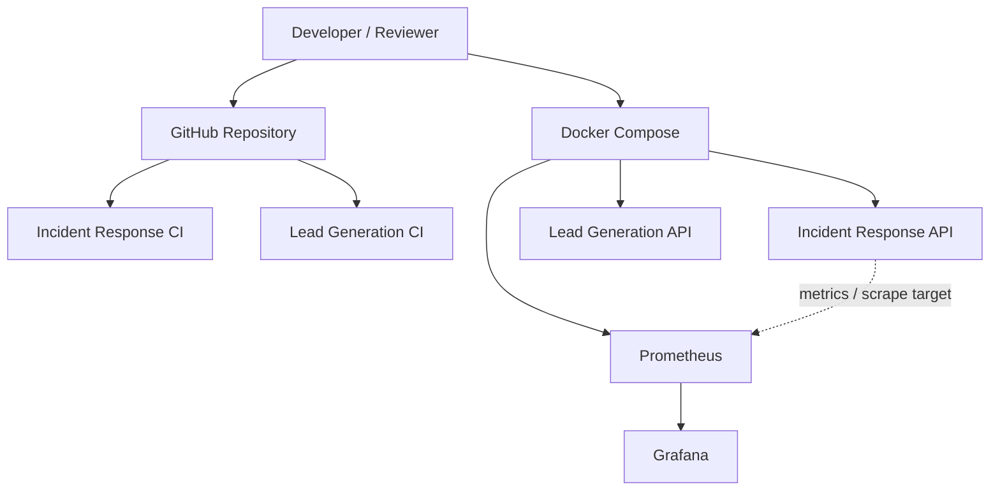

The repository is organized around two independent application workflows. Docker Compose provides a convenient local demonstration environment, while the CI workflows provide separate validation paths.

### Local service topology

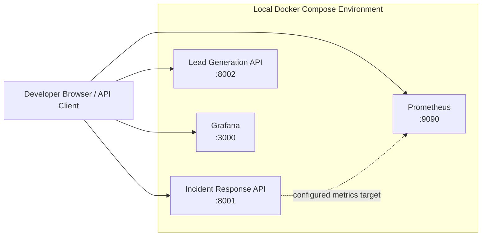

The ports above are the documented local endpoints in the Compose quick start. Confirm the active Compose configuration before exposing any service beyond the local machine.

---

## Project 1: AI DevOps Incident Response Assistant

### Purpose

The Incident Response Assistant demonstrates an operator-support workflow for common infrastructure and application symptoms. It is intended to help an engineer organize incident context, find relevant operational guidance, and review a structured diagnostic recommendation.

The assistant is **not an autonomous remediation engine**. It does not execute shell commands, cloud API calls, Kubernetes changes, network changes, or other infrastructure modifications.

### Incident workflow

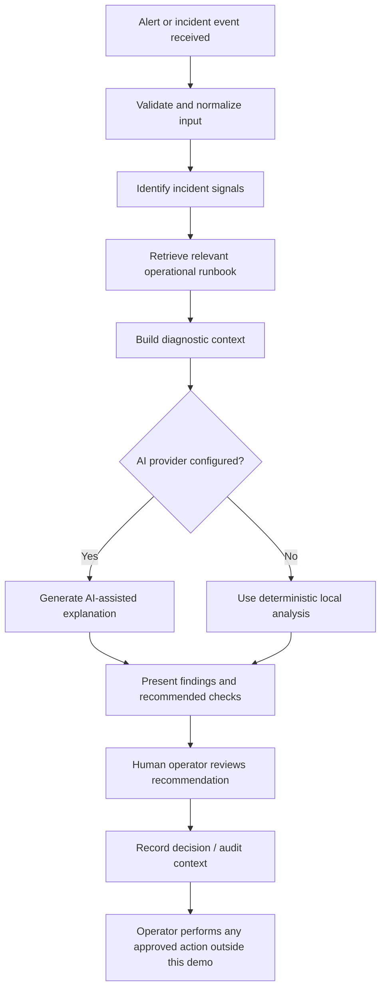

### Main capabilities represented in this repository

- Alert and incident input through the application API.
- Input validation and normalization.
- Runbook guidance for CPU saturation, memory pressure, and service latency.
- Diagnostic recommendation generation.
- Optional live LLM analysis when an OpenAI API key is configured.
- Deterministic local analysis when no provider key is configured.
- Human review and auditable decision concepts.
- API tests and a Prometheus configuration.
- Terraform files documenting an infrastructure-as-code starting point.

### Example diagnostic lifecycle

| Stage | What happens | Expected operator outcome |
|---|---|---|
| Alert intake | An event is submitted to the API | A normalized incident record |
| Context gathering | Relevant signals and runbook material are selected | A focused troubleshooting context |
| Analysis | Local rules or optional AI analysis summarize likely causes | A diagnostic explanation |
| Recommendation | Suggested checks or next steps are presented | A reviewable action plan |
| Human decision | An operator evaluates the recommendation | An accountable human decision |
| Follow-through | The operator uses approved operational procedures | Changes remain outside automated execution by this demo |

### Runbooks

The project includes operational guidance for:

- `runbooks/cpu-saturation.md` — investigating sustained CPU pressure.
- `runbooks/memory-pressure.md` — investigating memory utilization and pressure.
- `runbooks/service-latency.md` — investigating elevated service response times.

Use the runbooks as a starting point. Adapt thresholds, commands, escalation paths, and rollback steps to the actual environment before operational use.

### Incident API

When running the Compose environment, the API documentation is available at:

- Swagger UI: [http://localhost:8001/docs](http://localhost:8001/docs)

The exact routes and request schemas are defined by `01-ai-devops-incident-response/app/main.py`. Consult that file or the generated API documentation for the current implementation rather than assuming endpoints not documented here.

---

## Project 2: AI Lead Generation Agent

### Purpose

The Lead Generation Agent demonstrates a controlled lead-intake and qualification workflow. It accepts supplied lead information, validates records, applies transparent scoring, and can optionally generate a concise AI summary to help a person review the lead.

The project is designed around **review-first processing**. It does not implement automatic unsolicited outreach. CRM integration remains a safe mock or adapter boundary until credentials, permissions, consent, and field mappings are reviewed.

### Lead processing workflow

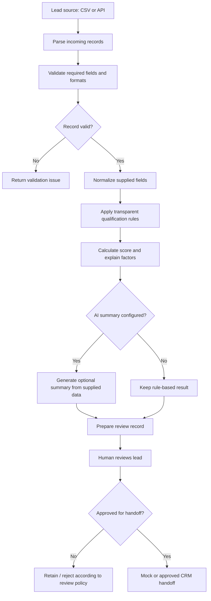

### Main capabilities represented in this repository

- CSV and API-based lead intake.
- Input validation and normalization.
- Transparent, rule-based lead scoring.
- Optional AI-generated summaries.
- A static demonstration UI in `frontend/index.html`.
- Sample data in `sample-leads.csv`.
- API tests.
- A review-first CRM handoff boundary.

### Scoring and review

The scoring process should be understandable to the reviewer. Qualification factors and thresholds should be inspected in the application code and adjusted to the business's approved criteria. A score is a prioritization aid, not a guarantee of purchase intent, identity, suitability, or conversion.

### Lead API

When running the Compose environment, API documentation is available at:

- Swagger UI: [http://localhost:8002/docs](http://localhost:8002/docs)

The current API routes and payload schemas are defined in `02-ai-lead-generation-agent/backend/main.py`.

---

## Technology stack

The repository currently documents and includes the following technologies and engineering practices:

| Category | Components / practices |
|---|---|
| Application APIs | Python application services |
| API documentation | OpenAPI / Swagger UI exposed by the running APIs |
| Containers | Dockerfiles and Docker Compose |
| CI | GitHub Actions, with separate project workflows |
| Infrastructure as Code | Terraform starter files for the incident-response project |
| Monitoring | Prometheus configuration and Grafana service in the local Compose environment |
| Testing | Project-specific API test suites |
| Operational documentation | Runbooks, architecture, deployment, security, and measurement notes |
| AI integration | Optional OpenAI API integration; deterministic local behavior without a key |

This table describes the repository's documented implementation. It does not imply that every optional integration has been configured for a production account or deployed to a cloud environment.

---

## Prerequisites

For the recommended local run:

- Windows, macOS, or Linux.
- Docker Desktop or Docker Engine with Docker Compose support.
- Git.
- A terminal such as PowerShell, Windows Terminal, Bash, or Zsh.
- Optional: an OpenAI API key if you want to test live LLM analysis.

Check your tools:

```bash
git --version
docker --version
docker compose version
```

---

## Quick start with Docker Compose

### 1. Clone the repository

```bash
git clone https://github.com/demy2014/AI-DevOps-Portfolio-Examples.git
cd AI-DevOps-Portfolio-Examples
```

If your local directory or GitHub repository uses a different name, adjust the `cd` command accordingly.

### 2. Create your local environment file

PowerShell:

```powershell
Copy-Item .env.example .env
```

Bash:

```bash
cp .env.example .env
```

Open `.env` and review its values. Add an `OPENAI_API_KEY` only if you intend to use live LLM analysis and have approved the associated data handling. Never commit `.env`.

The demo is designed to use deterministic local analysis when no API key is configured.

### 3. Build and start the services

```bash
docker compose up --build -d
```

### 4. Check service status

```bash
docker compose ps
```

### 5. Open the local endpoints

| Service | Local URL | Purpose |
|---|---|---|
| Incident Response API | [http://localhost:8001/docs](http://localhost:8001/docs) | API documentation and interactive testing |
| Lead Generation API | [http://localhost:8002/docs](http://localhost:8002/docs) | API documentation and interactive testing |
| Prometheus | [http://localhost:9090](http://localhost:9090) | Metrics collection and query interface |
| Grafana | [http://localhost:3000](http://localhost:3000) | Dashboard interface |

The documented Grafana demo credentials are `admin` / `change-me-now`. Treat these as local-demo defaults only. Change them before any shared or non-local deployment, and verify the actual values in your Compose and environment configuration.

### 6. Follow logs

```bash
docker compose logs -f
```

To follow one service, use its service name from `compose.yaml`:

```bash
docker compose logs -f <service-name>
```

### 7. Stop the environment

```bash
docker compose down
```

To remove named volumes as well, review the Compose file first and then run:

```bash
docker compose down --volumes
```

This can permanently delete local persisted demo data.

---

## Run services individually

Each project has its own `requirements.txt` and README. The following is a general Python 3.11+ workflow; use the project-specific README for exact environment variables and commands.

### Incident Response Assistant

PowerShell:

```powershell
cd 01-ai-devops-incident-response
py -3.11 -m venv .venv
.\.venv\Scripts\Activate.ps1
python -m pip install --upgrade pip
pip install -r requirements.txt
```

Bash:

```bash
cd 01-ai-devops-incident-response
python3.11 -m venv .venv
source .venv/bin/activate
python -m pip install --upgrade pip
pip install -r requirements.txt
```

Set `DATABASE_URL` as appropriate for the selected local setup. Then consult the project README and application entry point for the exact launch command.

### Lead Generation Agent

PowerShell:

```powershell
cd 02-ai-lead-generation-agent
py -3.11 -m venv .venv
.\.venv\Scripts\Activate.ps1
python -m pip install --upgrade pip
pip install -r requirements.txt
```

Bash:

```bash
cd 02-ai-lead-generation-agent
python3.11 -m venv .venv
source .venv/bin/activate
python -m pip install --upgrade pip
pip install -r requirements.txt
```

Consult the project README and `backend/main.py` for the exact launch command, environment variables, and current API behavior.

---

## CI/CD and quality workflow

The repository contains two independent GitHub Actions workflows:

- `.github/workflows/incident-response-ci.yml`
- `.github/workflows/lead-generation-ci.yml`

### CI workflow concept

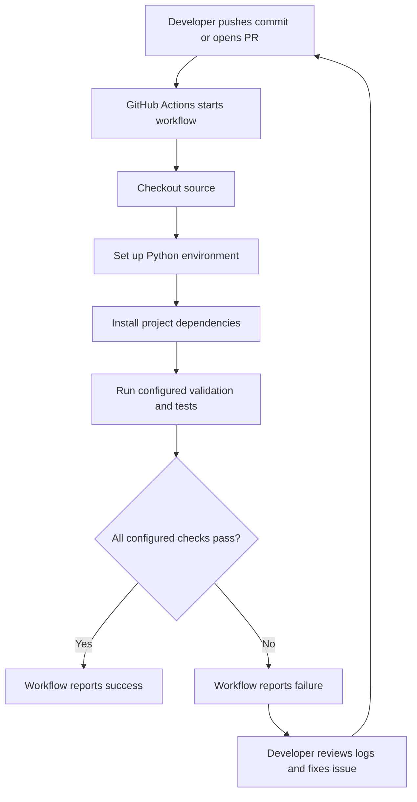

The actual workflow steps and triggers are defined in the YAML files. Review those files for the precise checks currently enabled. A passing CI workflow indicates that the configured automated checks passed; it does not prove production readiness, security certification, or deployment success.

### Suggested contribution workflow

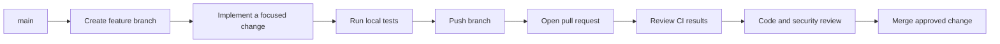

Example Git commands:

```bash
git switch -c feature/update-incident-runbook
# Make and test your changes
git add .
git commit -m "docs: improve incident response runbook"
git push -u origin feature/update-incident-runbook
```

Open a pull request on GitHub and merge only after the required review and checks are complete.

---

## Observability

The local Compose environment includes Prometheus and Grafana. The incident-response project includes a Prometheus configuration at:

```text
01-ai-devops-incident-response/monitoring/prometheus.yml
```

### Monitoring data flow

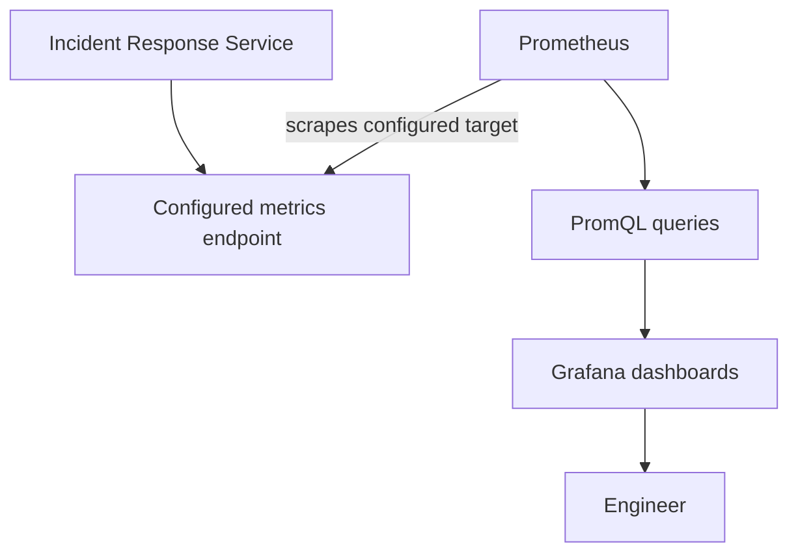

Confirm that the scrape target and metrics endpoint in the actual configuration match the running service. The presence of Prometheus and Grafana in Compose does not, by itself, prove that every desired metric, dashboard, alert rule, or notification channel has been configured.

### Suggested operational signals

For a production implementation, consider instrumenting and reviewing:

- Request rate, error rate, and latency.
- API availability and dependency health.
- Incident intake volume and processing duration.
- Runbook retrieval success and failure.
- AI provider latency, error rate, and token/cost usage, where applicable.
- Lead intake volume, validation failures, and scoring distribution.
- Queue depth and retry counts, if asynchronous processing is introduced.

Define service-level objectives and alert thresholds using observed workload data rather than copying arbitrary demo values.

---

## Security, privacy, and human oversight

Security controls are part of the design, not an optional afterthought. See [`docs/security/controls.md`](docs/security/controls.md) for the repository's security notes.

### Incident response safety boundary

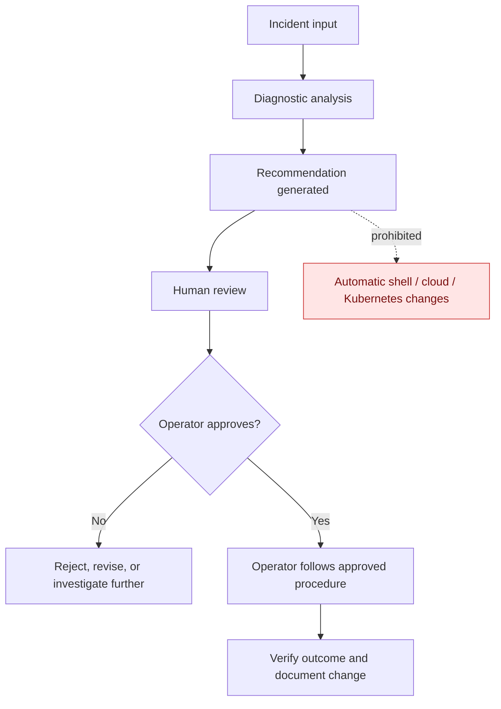

- Incident recommendations never execute shell, cloud, Kubernetes, or network changes.
- Approval records represent an auditable human decision; they are not an execution trigger.
- Validate all incident input and treat alert text, logs, and retrieved documents as untrusted data.
- Do not expose secrets, tokens, internal hostnames, or sensitive incident details in public logs or prompts.

### Lead generation safety boundary

- Lead enrichment uses only supplied data or explicitly approved sources.
- No scraping, personal-data inference, or automatic unsolicited outreach is implemented.
- CRM integration remains a safe mock/adapter until credentials, scopes, consent, retention, and field mappings are reviewed.
- Lead scores and AI summaries are decision-support signals and require human review.
- Apply applicable privacy, marketing-consent, and data-retention requirements before using real personal data.

### General security checklist

- Keep `.env`, credentials, tokens, and private keys out of Git.
- Use `.env.example` for placeholders only.
- Rotate any credential that is accidentally committed.
- Use least-privilege service identities and narrowly scoped permissions.
- Pin and regularly review dependencies.
- Restrict network exposure; keep demo services bound to trusted local interfaces where practical.
- Change demo passwords before shared use.
- Add authentication, authorization, rate limiting, secure secret management, and audit retention before production deployment.
- Complete a privacy and security review before processing real data.

---

## Testing and validation

Each project includes a `tests/` directory with API tests.

Run the test commands from the relevant project directory after installing its dependencies. A typical command is:

```bash
python -m pytest -q
```

If `pytest` is not installed in the project's dependencies, install the project's documented test dependencies first and update the dependency file as appropriate.

### Validation checklist

- [ ] Docker and Docker Compose versions are available.
- [ ] `.env` is created locally and is not tracked by Git.
- [ ] Compose services build successfully.
- [ ] Compose services report healthy or running as appropriate to their health-check configuration.
- [ ] Incident API documentation loads on port `8001`.
- [ ] Lead API documentation loads on port `8002`.
- [ ] Prometheus is reachable on port `9090`.
- [ ] Grafana is reachable on port `3000`.
- [ ] Incident-response tests pass.
- [ ] Lead-generation tests pass.
- [ ] Both GitHub Actions workflows complete successfully.
- [ ] No real personal data, production logs, or secrets are included in sample artifacts.

---

## Operational workflows

### Local startup and shutdown

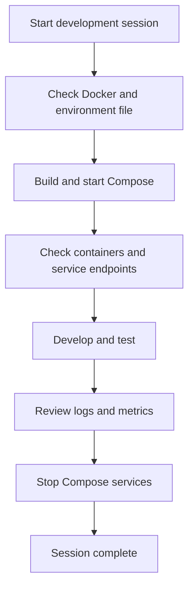

### Incident review lifecycle

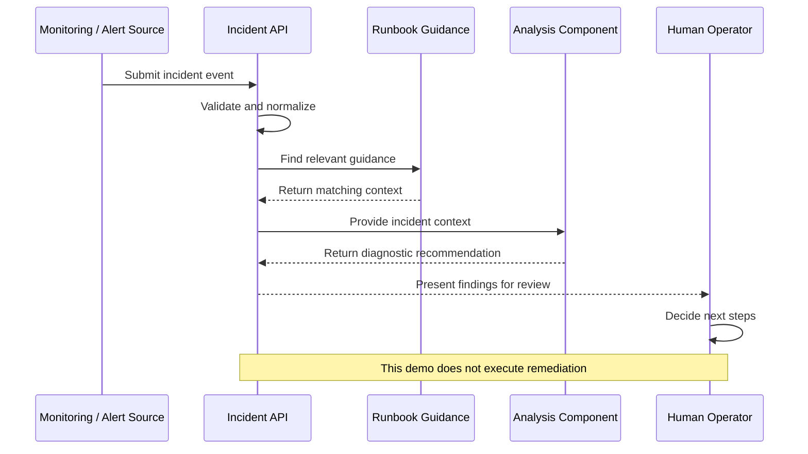

---

## Evidence and measurement

This portfolio is intended to demonstrate engineering practices, not to claim unverified production outcomes.

For a credible technical walkthrough, capture:

1. A clean Git clone and successful Compose build.
2. `docker compose ps` showing the running services.
3. API documentation pages for both applications.
4. Example requests and responses using synthetic data.
5. Test output from both project test suites.
6. GitHub Actions workflow results from actual runs.
7. Prometheus targets and any dashboards that are actually configured.
8. A sample incident recommendation and the corresponding human review.
9. A sample lead record showing validation, score factors, and review status.
10. Deployment logs and measured timings if a real deployment is performed.

### Suggested metrics to collect

| Dimension | Example measurement | Evidence source |
|---|---|---|
| Build reliability | Successful builds / total builds | CI run history |
| Test quality | Tests passed / tests executed | Test output |
| API performance | p50 / p95 response time | Load test results |
| Incident workflow | Time from intake to recommendation | Timestamped demo events |
| Runbook usefulness | Relevant runbook retrieval rate | Reviewed test cases |
| Lead processing | Valid records / submitted records | Synthetic CSV/API test |
| Scoring transparency | Records with explainable score factors | API responses / test cases |
| Operational visibility | Configured targets and dashboards | Prometheus / Grafana evidence |

Do not claim production uptime, customer impact, conversion lift, cost savings, or incident MTTR improvements unless they have been measured in a representative environment and the measurement method is documented.

---

## Known limitations and next steps

This repository is a portfolio demonstration. The following items require additional implementation and validation before production use:

- Authentication and role-based authorization.
- Production-grade database migrations, backup, recovery, and retention policies.
- Managed secrets and key rotation.
- Rate limiting, abuse protection, and stronger input-size controls.
- Centralized structured logging and distributed tracing.
- Alert rules, notification routing, and tested on-call procedures.
- Infrastructure-specific Terraform review, state management, and environment separation.
- Deployment automation with approvals, rollback, and post-deployment verification.
- Security scanning, dependency management, and container image hardening.
- Formal privacy review and data lifecycle controls.
- A real CRM integration with approved credentials, scopes, consent, and mapping.
- Load, resilience, and failure-mode testing.

### Suggested roadmap

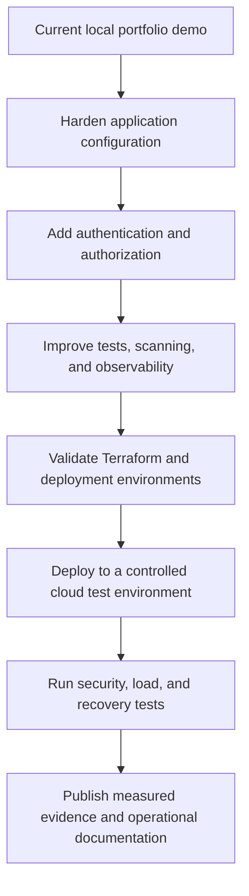

The roadmap is a proposed progression, not a statement that these production capabilities are already complete.

---

## Troubleshooting

### Docker Compose command is not recognized

Install or update Docker Desktop / Docker Engine with Compose support, restart the terminal, and verify:

```bash
docker --version
docker compose version
```

### A port is already in use

Check whether another local process is listening on `8001`, `8002`, `9090`, or `3000`. Stop the conflicting process or update the relevant port mapping in `compose.yaml`, then restart the stack.

### A container exits during startup

Inspect the service logs:

```bash
docker compose ps
docker compose logs <service-name>
```

Check required environment variables, dependency installation, port conflicts, and the service's own README.

### Live AI analysis is unavailable

Confirm that the local `.env` contains a valid `OPENAI_API_KEY`, that the key is available to the relevant container, and that outbound access is permitted. Do not paste API keys into issues, screenshots, commits, or chat messages. Without a configured key, the demo is expected to use deterministic local analysis where implemented.

### Git reports that `.env` is tracked

Check:

```bash
git status
git ls-files .env
```

If `.env` was staged but not committed, unstage it and ensure `.env` is listed in `.gitignore`:

```bash
git rm --cached .env
```

If a secret has already been committed or pushed, removing the file in a later commit is not enough. Revoke or rotate the exposed secret and follow GitHub's guidance for sensitive-data removal.

---

## License

See [`LICENSE`](LICENSE) for the terms governing use and distribution.

---

## About this portfolio

This repository is a practical demonstration of cloud and DevOps engineering concepts applied to two AI-assisted workflows: operational incident support and lead qualification. The emphasis is on clear architecture, repeatable development, automation, observability, security boundaries, human oversight, and evidence-based engineering claims.
