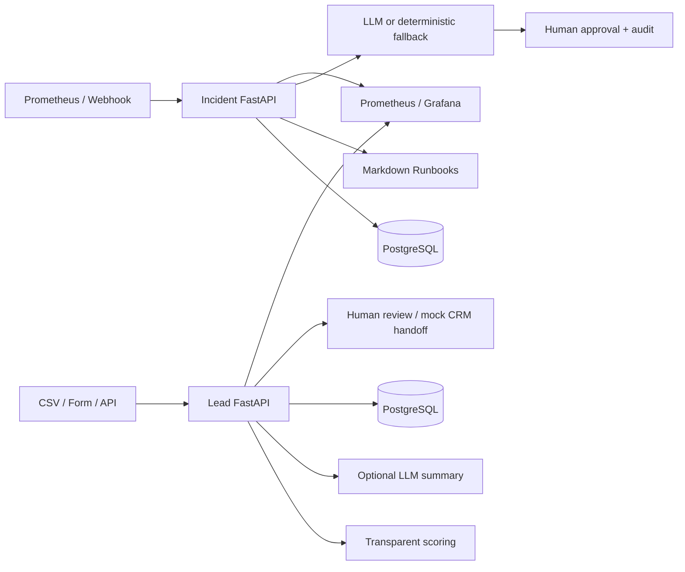

# Portfolio architecture

Services share a local PostgreSQL instance in Compose but own separate tables and API processes. Split databases and credentials for production. AI providers are optional and have deterministic fallback behavior.
